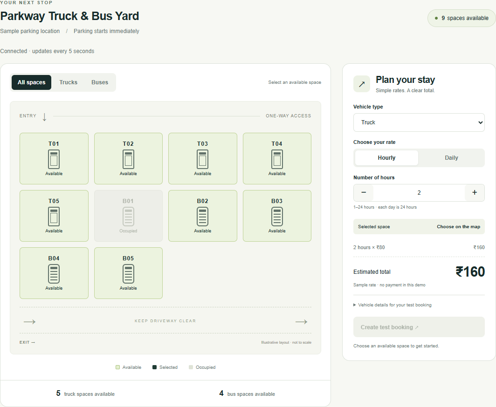
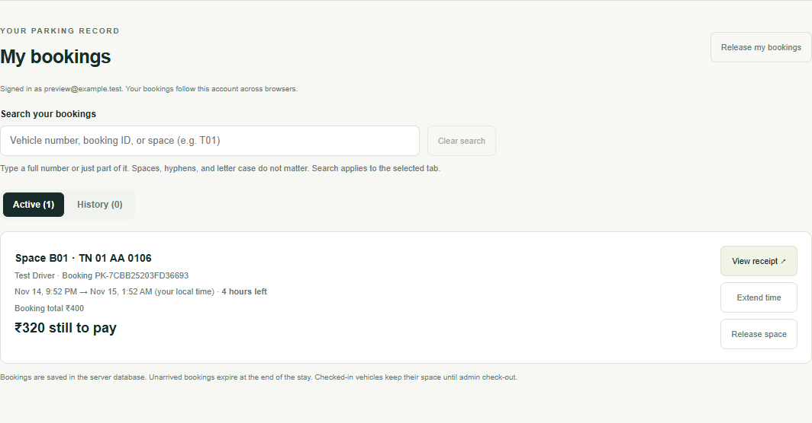
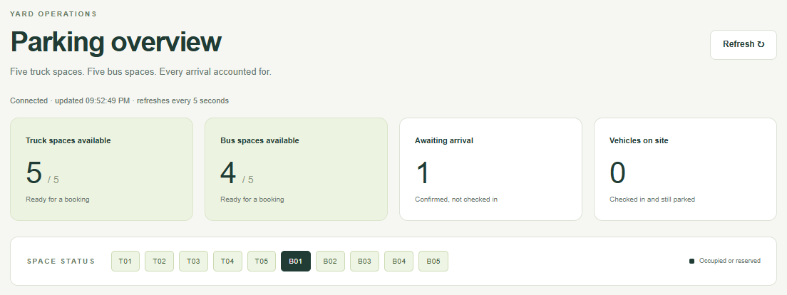

# Smart parking — customer accounts and admin

HTML, CSS, and JavaScript frontend with a Python HTTP server and SQLite database. Python 3.10 or newer is required. No extra packages or database installation are needed.

## Screenshots

**Find a space.** In this sample yard, bus space B01 is booked. Drivers can see the nine available spaces and compare hourly and daily rates.



**Manage a booking.** The driver has four hours left on a ₹400 booking and owes ₹320 after an ₹80 payment. From the same card, they can extend the stay or open the receipt.



**Track arrivals.** The admin sees the same B01 reservation under “Awaiting arrival” and can check which spaces are free.



## Run in VS Code

1. Open the Desktop `smart-parking` folder in VS Code.
2. Open **Terminal → New Terminal**. Stop any old server with **Ctrl+C**.
3. Run:

   ```powershell
   python server.py
   ```

   If `python` is not recognized, use `py -3 server.py`.

4. Open **http://localhost:8000** in your browser. Press **Ctrl+F5** once after this upgrade.
5. Wait for **Connected · updates every 5 seconds** above the parking map.
6. Stop with **Ctrl+C**. Bookings stay saved after stopping and restarting.

Use this new command instead of `python -m http.server`. Opening `index.html` directly or using Live Server alone cannot run the database/API. If port 8000 is occupied, stop the old server or run `python server.py --port 8001`, then visit http://localhost:8001.

## Check customer accounts in two browsers

1. Open http://localhost:8000 in your regular browser.
2. Click **Sign in / Create account**, then **New here? Create an account**. Use a test name, email, and a password of 10–128 characters. No verification email is sent in this local demo.
3. Select Trucks and book T01 for 2 hours. The price is ₹160 and 4 truck spaces remain.
4. Open the **same address** in a private/incognito window, or in another browser. Sign in with the **same email and password**. Your active booking should appear under **My bookings**.
5. Release T01 in either browser. Within 5 seconds, both views show 5 available truck spaces. Open **History** to see the released booking.
6. Sign out in the second browser and create a **different account**. It sees shared availability but cannot see or release the first account's bookings.
7. Make another test booking, stop and restart the server, and refresh. The booking and account should remain saved.

Regular tabs in one browser profile share sign-in. Signing out affects those tabs on their next refresh, but other browsers stay signed in. Always use the same hostname: `localhost` and `127.0.0.1` share the database, but browsers keep separate cookies for them. The local server is reachable only on this computer; access from other devices will require a later hosting setup.

## What is saved

- SQLite is created automatically at `data/parking.sqlite3` inside this folder.
- It stores 5 truck spaces, 5 bus spaces, customer accounts, browser sessions, admin credentials, and booking records.
- The browser only saves the vehicle-filter preference and a session cookie. Booking data comes from the server.
- New bookings require customer sign-in. Clearing cookies or signing out does not delete account bookings: sign in again to see them. Customer sessions last 30 days.
- Previous server bookings belong to their original browser until you sign in or create an account there. They then join that account, including history. Only bookings from that browser session are transferred. If its cookie has already been lost, the admin can still manage the booking; it cannot be claimed using a driver name or email.
- The first upgrade creates `data/parking.before-accounts.sqlite3` before adding account ownership fields. Existing bookings and the admin password are preserved. Keep this backup private.
- The earlier browser-only demo bookings are **not imported**. Their browser data is left untouched; this version starts with its own database.
- Unarrived expired bookings and released bookings remain as history without occupying a space. Checked-in bookings stay active until admin check-out, including after the booked end time.

To back up the database, stop the server and copy the entire `data` folder. Do not edit or delete it while testing persistence. If the Desktop is synced with OneDrive, use only one machine's running server against that database folder; cloud file sync is not a shared database server.

## Rates and expiry

| Vehicle | Per hour | Per 24-hour day |
| --- | ---: | ---: |
| Truck | ₹80 | ₹600 |
| Bus | ₹100 | ₹800 |

The table above shows the initial prices. To change them, sign in at `/admin`, open **Price settings**, edit the four fields, and click **Save prices**. Use whole rupees from ₹1 to ₹1,00,000. Prices are saved in the database and survive restarts; no code edits or restart are needed after saving. The customer page fetches updated prices within its normal 5-second refresh. Existing bookings and receipts keep their original amounts. If a price changes while a customer submits a booking, the current website asks them to review the updated total and book again.

Unsaved admin edits stay in the form during automatic refreshes. If another admin window saves first, click **Reload current prices**, then edit again. This clears unsaved edits and prevents accidentally overwriting newer prices. `RATES` in `server.py` now supplies defaults only when initializing the price settings table.

Hourly duration is 1–24 whole hours; daily duration is 1–30 whole days. A day is exactly 24 hours. Daily prices are not automatically applied to hourly bookings. All bookings start immediately. The server determines start time, end time, and total; client-supplied prices or timestamps cannot override them.

Availability excludes unarrived bookings after their end time, including when the page or server has been closed. Checked-in vehicles continue occupying their spaces until an admin checks them out. The page polls every 5 seconds while running and refreshes when you return to it. Browser background throttling may delay polling; a refresh checks immediately. Displayed dates use your browser's local timezone.

This is a test booking system. The admin page now records staff check-in and check-out; there are no sensors. Check in arriving vehicles so their spaces remain occupied until staff confirms departure.

## Backend behavior

- SQLite transactions protect the availability check and booking write together, preventing concurrent reservations for the same space.
- Repeated submissions with the same request ID return the original booking instead of creating another one.
- The server validates durations, space IDs, and required text fields.
- Browser sessions use random HttpOnly, SameSite cookies. Mutation requests require a matching session, origin, and CSRF token.
- Other customers see occupied spaces, not private booking details. Customer release actions affect only their account's unarrived bookings. Checked-in vehicles require admin check-out.
- Customer passwords use salted PBKDF2-SHA256 hashes. Sign-in rotates the session and CSRF token; sign-out revokes that browser's session. Five wrong attempts for an account trigger a one-minute cooldown.
- **Active** shows current bookings; **History** shows the latest 100 past bookings with released, expired, cancelled, or checked-out status and the total history count.
- Only approved customer and admin page assets are served; database and Python source files are not available over HTTP.

## API

| Method | Path | Purpose |
| --- | --- | --- |
| GET | `/api/state` | Availability, rates, current customer, own active bookings/history, and CSRF token |
| POST | `/api/customer/signup` | Create an account with name, email, and password; sign in and claim this browser's legacy bookings |
| POST | `/api/customer/login` | Sign in with email/password and claim this browser's legacy bookings |
| POST | `/api/customer/logout` | Revoke this customer session and return a new anonymous session/CSRF token |
| POST | `/api/bookings` | Create an immediate booking; customer sign-in required |
| POST | `/api/bookings/{id}/release` | Release one owned unarrived booking |
| POST | `/api/bookings/release-all` | Release own unarrived bookings only |

Booking JSON: `spaceId`, `unit` (`hour` or `day`), integer `duration`, `driver`, `plate`, and unique `requestId`. POST requests require `Content-Type: application/json`, the browser session cookie, matching `Origin`, and `X-CSRF-Token` returned by `/api/state`.

## Search My bookings

Use **Search your bookings** above the Active/History tabs. Enter all or part of a vehicle registration, booking ID, or parking space (for example `1234`, `PK-...`, or `B01`). Spaces, hyphens, and letter case are ignored. Results update as you type; **Clear search** restores the normal list. Your query stays in place when switching between Active and History.

Only your own bookings are searched. History search covers all your saved records, including records older than the default latest 100. Up to 100 matching past bookings appear, with the matching total shown; narrow your search if needed. The tab counts remain your full active/history totals. Search does not change parking availability or bookings. Individual release and receipt actions remain available on results, while the bulk **Release my bookings** button is hidden during search to avoid releasing records outside the results. Search resets when signing in/out or after a successful new booking.

The optional `/api/state?search=...` query accepts up to 80 characters and returns matching bookings plus `bookingsTotal`, `historyTotal`, and `historyMatches`. Database ownership checks apply before search matching. No database migration is required.

## Vehicle registration checks

- Enter a common permanent Indian truck/bus registration, for example `TN 01 AB 1234`, `KA 01 AB 1234`, or Delhi-style `DL 1 PC 1234`.
- Lowercase letters become uppercase. Spaces and hyphens are accepted. On leaving the field or booking, entries are formatted consistently, for example `tn-1-ab-7` becomes `TN 01 AB 0007`.
- New bookings require a recognized two-letter state/UT code, one or two RTO digits, one to three series letters, and one to four final digits. A letter series is mandatory in this app: `WB 55 5577` is rejected, while `WB 55 AB 5577` has the supported structure. Enter the actual letters printed on the vehicle; do not invent a series. Zero RTO/serial numbers, punctuation, unknown state codes, and incomplete numbers are rejected. Legacy state codes such as OR, TS, and UA remain accepted. This app intentionally does not accept no-series registrations for new bookings.
- This is a format check, not a government database lookup. It does not verify vehicle ownership, issuance of a specific RTO/series, or vehicle class. Temporary, diplomatic, military, and older three-letter registrations are outside this version. BH-series is not supported in this truck/bus form; the official scheme concerns non-transport vehicles.
- One vehicle can have only one active booking across all spaces and customer accounts. Changing case, spaces, hyphens, or leading zeros does not bypass this rule. The check and booking write happen in one database transaction.
- A vehicle can book again after its unarrived booking is released, cancelled, or expires. A checked-in vehicle remains blocked, even after its booked end time, until admin check-out.
- Existing records, including earlier test numbers, are preserved. Existing valid registrations are compared using the same normalization. Any duplicate records created before this upgrade remain manageable by admin; this upgrade does not cancel them automatically.

Quick test: book `TN 01 AB 1234`, then try `tn-01-ab-1234` on another available space. The second booking should be rejected. Try `TN 01 AB 5678` for a different vehicle; that booking should succeed. `TEST 01` should show a format error.

Format references: [Delhi Transport registration examples](https://transport.delhi.gov.in/transport/vehicle-registration) and [official BH-series notification](https://static.pib.gov.in/WriteReadData/specificdocs/documents/2021/aug/doc202182801.pdf). These inform the supported formats, not a claim that the demo validates every Indian registration type.

## Booking receipts

1. Sign in and open **My bookings**.
2. Click **View receipt** on an Active or History booking.
3. The receipt shows the booking ID, driver, vehicle registration/type, parking space, booked start/end times, duration, original rate, total, and current status. Recorded check-in/check-out times appear when available.
4. Click **Print / Save as PDF**. In Chrome or Edge's print window, select **Save as PDF** as the destination, then save. You can also choose your printer. For a clean copy, turn off the browser's optional headers and footers.
5. Click **My bookings** to return to the parking page.

Receipts use the stored original booking price, even if the site's rates later change. The payment section shows **Unpaid**, **Part paid**, or **Paid**, the amount paid, remaining balance, and Cash/UPI amounts recorded by staff. Corrected entries are excluded from those amounts. A cancellation or release does not automatically refund or erase a payment. This local demo does not verify bank transactions or issue tax invoices. Use **Refresh receipt** after staff records a payment. The page refreshes the receipt before printing and includes its load time and timezone. A saved PDF is a snapshot; open the receipt again to see a later booking status.

Receipt details require the booking owner's session. Sharing the URL does not give another customer access. Existing guest bookings can still be viewed from their original browser, and account bookings can be viewed from any browser signed into that account. No database migration is needed for receipts.

## Files and tests

- `server.py`: server, database schema, rates, validation, booking rules, session handling.
- `app.js`: page interactions and API calls.
- `index.html`, `styles.css`: page content and appearance.
- `admin.html`, `admin.css`, `admin.js`: the admin sign-in page and dashboard.
- `receipt.html`, `receipt.css`, `receipt.js`: the customer receipt page and print layout.
- `test_server.py`, `test_admin.py`, `test_customer.py`, `test_receipt.py`, `test_vehicle.py`, `test_search.py`, `test_prices.py`, `test_extensions.py`, `test_reports.py`, `test_excel_report.py`, `test_space_blocks.py`, `test_backups.py`, `test_payments.py`: automated HTTP/database tests using disposable databases.
- `ADMIN.md`: admin setup and usage instructions.
- `.gitignore`: keeps database files and Python caches out of Git.

Run the backend checks with `python -m unittest -v test_server test_admin test_customer test_receipt test_vehicle test_search test_prices test_extensions test_reports test_excel_report test_space_blocks test_backups test_payments`. They cover accounts, shared availability, simultaneous reservations, rates, invalid inputs, retries, ownership, expiry, restarts, database upgrades, admin actions, receipts, vehicle validation, duplicate-vehicle races, private booking search, price settings, and request/file protection. Test databases are temporary and do not modify your parking database.

## Forgotten customer password

For this local demo, the site owner can reset a customer's password in the VS Code terminal. Stop the server, then run the following with the customer's actual sign-in email:

```powershell
python server.py --reset-customer customer@example.com
```

Enter the new password twice when prompted; input is hidden. All sessions for that customer are signed out, and their bookings remain saved. Restart with `python server.py`. There is no email reset link, email verification, or self-service password change yet. Customer passwords are separate from the admin password.

## Extend parking time

In **My bookings → Active**, choose **Extend time** on a booking. Add 1–24 hours or 1–30 days, click **Preview extension**, review the additional cost and new end time, then **Confirm extension**. Each day is 24 hours. Previewing or closing the dialog makes no booking changes.

The added time starts at the existing booked end, using the current rate for the chosen unit. The original booking and previous extensions keep their recorded prices. Receipts list every charge separately; the booking card and admin dashboard show the updated end time and combined total. No payment is collected.

Unarrived bookings can be extended only before they expire. Checked-in vehicles, including overdue ones, can extend while still parked; added time must bring the end time into the future, so it covers the overdue period too. Released, cancelled, expired unarrived, or checked-out bookings cannot be extended. Extensions keep the same space reserved.

If prices or the booking change in another window, preview again before confirming. Retrying a failed confirmation with the same request is safe and does not add time twice. Only the booking owner's signed-in account can extend it. The new `booking_extensions` table stores each addition; existing booking records and account data are preserved during upgrade. Source backup: `backup-before-extensions.zip`.

The API uses authenticated, CSRF-protected POST requests to `/api/bookings/{id}/extension-quote` and `/api/bookings/{id}/extend`. Confirmations include the preview's current end, total, rate, and a unique request ID; the server checks these and calculates the amount inside a transaction. Run extension tests with `python -m unittest -v test_extensions`.

## Scope and next steps

The server listens only on this computer at `127.0.0.1`. This is a local development version, not a public service. There are no real payments, future-arrival scheduling, or sensors yet. The admin page uses a separately configured local password. Use fictional customer and driver details and a test password while testing.

Admin setup: see `ADMIN.md` or run `python server.py --set-admin` to choose your password. Then start the server and visit http://localhost:8000/admin.

Next: prepare hosting with HTTPS, suitable production serving, account verification/recovery, backups, and operational availability rules. The JSON API structure can be reused for a future mobile app.

## Daily admin reports

In `/admin`, open **Daily reports**, select a date, and click **Show report**. Reports use IST (UTC+05:30) and include new bookings, extensions, actual arrivals/departures, and gross recorded amounts. The amounts are not payments received and include bookings later cancelled or released. Original booking amounts stay on the booking date; extension amounts go on their confirmation dates. Current statuses are labelled separately.

Use **Download Excel (.xlsx)** for a formatted workbook with Summary and Events sheets, sized columns, wrapped text, date and rupee formats, frozen event headings, and filters. Keep `excel_report.py` and `report-template.xlsx` beside `server.py`; no additional packages are required. Reports and downloads require admin authentication and include all matching events. Refresh a report manually to see newer activity. Read-only endpoints: `GET /api/admin/reports?date=YYYY-MM-DD` and `GET /api/admin/reports.xlsx?date=YYYY-MM-DD`. The original `/api/admin/reports.csv` endpoint remains available for CSV compatibility.


## Block spaces for maintenance

In the admin page, open **Manage spaces**. Select **Block space**, enter a short reason customers can see (up to 160 characters), then confirm. Blocked spaces show the reason on the customer map and are excluded from available counts. Use **Reopen space** when work is complete. Blocks persist after restarting the server.

A reserved space or a checked-in vehicle cannot be blocked, including overdue vehicles. Wait for an unarrived booking to expire, or record the actual vehicle departure. Blocking does not cancel or erase bookings. If another admin changes the same space, review the latest status before retrying. Customer pages refresh every five seconds; the server also prevents bookings made from an outdated page.


## Database backup and restore

In admin, open **Database backup & restore** and click **Download database backup**. The `.sqlite3` file includes bookings, extension charges, customer accounts and password hashes, admin credentials, check-in/check-out history, prices, and maintenance blocks. This is a database backup, not the Excel report or the source-code ZIP. Keep it private and copy it to another drive. The download requires an active admin login and includes committed bookings even while the website is running.

You can also run `python server.py --backup` in a second VS Code terminal. It saves a uniquely named file under `data/backups/` without stopping the server or overwriting older backups. These backups are manual; they are not scheduled automatically.

To restore:

1. Stop the server with **Ctrl+C**. Close any database editor using the parking database.
2. Run `python server.py --restore "FULL_PATH_TO_BACKUP.sqlite3"`, replacing the example path with the downloaded file's full path.
3. Check the backup date and booking/customer counts. Type **RESTORE** to continue, or press Enter to cancel.
4. The app saves the current database under `data/backups/before-restore-...sqlite3` before replacing it. If validation or this safety backup fails, the restore does not proceed. A missing database can also be restored.
5. Run `python server.py`, refresh the website, and sign in again. The passwords, prices, blocks and bookings are those saved in the backup. Newer records are no longer in the active database, but remain in the safety backup when one was created. Check actual vehicle occupancy after restoring an older snapshot.

Restore accepts backups created by this version of the app, validates their structure and records, and clears saved sign-in sessions. It does not run through a website upload. The new server prevents restore or a second server from opening the same database concurrently. A `.lock` file remains next to the database; the operating system releases the lock when the server exits, so do not delete it to force a restore. Stop the server before using either password-reset command as well.

Only restore backups you created and trust. Keep the current source files separately: the database backup does not contain the website code.


## Cash and UPI payment records

In admin, select **Payments** beside any booking. Enter the whole-rupee amount you have already received and choose **Cash** or **UPI**, then select **Record payment received**. Verify UPI receipt in your bank/payment app first. This feature records collections; it does not process payments or check bank transactions.

Bookings show **Unpaid**, **Part paid**, or **Paid**, plus the paid amount and remaining balance. Part payments and mixed Cash/UPI are supported. Extending a paid booking creates a new balance. The server rejects amounts above the balance, duplicate retries, and stale submissions from another admin window.

If an entry is incorrect, choose **Correct entry**, enter a reason, and confirm. The original entry stays in history. This corrects a record only and does not issue a refund. Cancellation, release and checkout do not remove payment records or automatically refund money.

Daily reports show gross booked charges separately from **Recorded collections**. Collections use the entry time in IST, even if the booking is from an earlier day. A correction is deducted on the correction date; it does not rewrite an older day's report. Cash, UPI and total collection values are net of those corrections and can be negative. The Excel download adds a **Payments** sheet and collection totals to **Summary**. Customer receipts show booking charges and current staff-recorded payments separately, with Cash/UPI amounts and the remaining balance. Staff correction notes stay private to admin.

Database backups now include payment entries and corrections. Backups from before payment tracking are still supported; restoring one starts with no payment entries. Keep a current backup before any restore.


## Payment reminder at checkout

Click **Check out** after a vehicle leaves. The dialog loads the latest booked total, amount paid, and remaining balance. Choose **Record payment** to enter Cash/UPI already received, then **Continue to checkout** to review the updated balance and confirm departure. Saving a payment alone does not check the vehicle out.

If money is still owed, tick **I confirm checkout with ... still unpaid**, then choose **Check out with balance**. The amount remains outstanding in the booking, receipt, and payment history; checkout does not mark it paid or waive it. Fully paid bookings need only the normal departure confirmation.

If a payment, correction, or extension changes the totals before confirmation, checkout is rejected. Open **Check out** again to review the current balance. **Go back** makes no changes. A balance-loading error keeps checkout disabled; use **Reload balance** after reconnecting. No database migration is needed for this update.


## Outstanding payments

Open **Outstanding payments** in admin to see every booking with a remaining balance, including checked-out vehicles and older records outside the dashboard's recent history. The total pending amount and booking count cover all matching bookings; the list shows 50 at a time, oldest first. Use **Previous** and **Next** for older/newer pages.

Cancelled, released and expired bookings are included because this app retains their recorded charges. Booking status is shown on each row. No payment is waived or collected automatically. **Record payment** opens the existing Cash/UPI form. A part payment reduces the balance; full payment removes that booking from the list. Correcting a payment can bring it back. The list refreshes after recording payment and every five seconds while open (except while an action dialog is open); **Refresh balances** reloads it manually. No database migration is needed.


### Search outstanding payments

In **Outstanding payments**, enter part of a vehicle number, driver name or booking ID. Select **Unpaid**, **Part paid**, or both, and optionally **Checked-out vehicles only**, then click **Apply filters** (or press Enter in the search box). Searches ignore letter case; spaces and hyphens in vehicle numbers and booking IDs are optional. Search terms are literal text, not wildcards.

The pending total and count cover all matching records across every results page, including older bookings. Applying or clearing filters starts at the first page. **Clear filters** restores all outstanding bookings. Applied filters remain active during refresh and payment recording; a booking disappears if it no longer matches after a payment. Filters reset when signing out.


### Download outstanding payments as Excel

In **Outstanding payments**, apply the search and filters you want, then select **Download Excel (.xlsx)**. The file includes **all matching bookings across every page**, the applied filters, snapshot time in IST, matching booking count and pending total. Unsaved changes in the filter form are not used until you click **Apply filters**. Downloading uses the latest saved balances, which can differ from an older screen view.

The workbook includes numeric dates and rupee amounts, calculated remaining balances and totals, frozen headings and Excel column filters. An empty result produces a valid workbook with zero totals and a clear empty-result message. The print layout uses A3 landscape, one page wide with as many pages tall as needed and repeated column headings. Choose your printer's paper size if needed. It is a snapshot: edits in Excel do not change website bookings or payments. Opening or downloading the report requires an admin session. Keep the new `outstanding-template.xlsx` file beside `server.py`; no additional Python packages are required.
## Balance waivers

Admins can open **Payments → Waive an amount**, enter part or all of the unpaid balance, review the remaining amount, provide a reason and confirm. For example, waiving ₹160 from ₹400 leaves ₹240 unpaid. Receipts show paid, waived and remaining amounts separately. Waivers reduce the amount owed without increasing recorded collections; gross booked charges remain unchanged. Admins can reverse an individual incorrect waiver with a reason. Waiver and reversal history is included in database backups.

